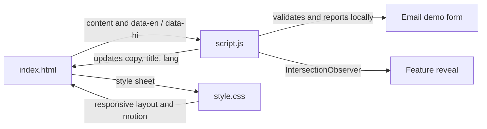

<div align="center">

# NETFLIX INDIA
### A cinematic, bilingual streaming landing-page concept

**A responsive front-end demo built with HTML, CSS, and vanilla JavaScript.**

[Explore the features](#-highlights) · [Run locally](#-run-locally) · [Publish with GitHub Pages](#-publish-with-github-pages)

<br>

> An independent educational project inspired by streaming landing pages. It is not affiliated with Netflix.

</div>

---

## ✨ Highlights

| Experience | What it does |
| --- | --- |
| 🎬 **Cinematic hero** | Layered artwork, dramatic gradients, ambient red light, and a responsive call to action. |
| 🌐 **English + हिन्दी** | Switch page copy, image descriptions, accessible labels, the email placeholder, document language, and title without reloading. **Sign In stays in English.** |
| 📺 **Feature showcase** | Four responsive sections introduce TV viewing, downloads, watching on different devices, and kids profiles. |
| 💬 **Interactive FAQs** | Keyboard-accessible, native disclosure panels with answers in both languages. |
| ✉️ **Demo email form** | Checks the email format and shows a localized message. It does **not** send or save form data. |
| ✨ **Subtle motion** | Staggered hero entrance, a gently breathing glow, scroll-reveal sections, and small hover details. |
| ♿ **Thoughtful defaults** | Semantic sections, descriptive image text, visible keyboard focus, and reduced-motion support. |
| 📱 **Responsive layout** | Adjusts the navigation, hero, feature artwork, FAQ, and footer for smaller screens. |

## 🖼️ Page tour

1. **Hero** — Switch language, follow the external Sign In link, or try the front-end-only email form.
2. **Features** — Scroll through the four numbered feature sections and their illustrative artwork.
3. **FAQs** — Expand a question with a click, Enter, or Space.
4. **Footer** — Visit the linked official Netflix resources.

## 🧰 Built with

- **HTML5** for semantic page structure and native FAQ disclosure elements.
- **CSS3** for responsive layouts, design tokens, gradients, animation, and reduced-motion preferences.
- **Vanilla JavaScript** for language switching, form feedback, and scroll-triggered reveals.
- **Google Fonts** for DM Sans and Manrope, with sans-serif fallbacks.

No framework, package manager, build step, or third-party JavaScript library is required.

## 🎓 Concepts demonstrated

This project is also a compact example of core front-end concepts:

- **Semantic HTML:** landmarks, heading hierarchy, labels, and native `<details>` / `<summary>` interactions.
- **DOM updates:** `data-en` / `data-hi` attributes drive a small client-side localization flow.
- **Form validation:** the browser's email validity API is paired with localized, accessible feedback—without pretending to submit data.
- **Responsive design:** fluid sizing, CSS custom properties, and media queries adapt the same content to different screens.
- **Progressive motion:** `IntersectionObserver` enhances feature reveals, while CSS honors reduced-motion preferences.

## 📁 Project structure

```text
.
├── index.html          # Page content, translations, metadata, and accessible markup
├── style.css           # Theme, responsive layouts, states, and animations
├── script.js           # Language switch, demo form, and scroll reveals
├── README.md           # Project guide and setup instructions
├── favicon.ico         # Browser tab icon
└── assets/
    ├── images/
    │   ├── bg.jpg      # Local hero background
    │   └── logo.svg    # Local logo artwork
    └── videos/
        └── video1.m4v  # Included local media asset; not currently used by the page
```

### How the page fits together



## 🚀 Run locally

### Option 1: Open the file

Open `index.html` in a modern browser. The main page and local artwork work without a build process. Some showcase images, videos, and fonts are loaded from external services and require an internet connection.

### Option 2: Start a local server

If Python is installed:

```bash
python -m http.server 8000
```

Open [http://localhost:8000](http://localhost:8000).

## 🌍 Publish with GitHub Pages

1. Create a GitHub repository and upload the project files, keeping `index.html` at the repository root.
2. Open the repository's **Settings → Pages**.
3. Under **Build and deployment**, choose **Deploy from a branch**.
4. Select the branch containing the project and the **/(root)** folder, then save.
5. Wait for the Pages deployment to finish and open the URL shown in the Pages settings.

The site is static, so it does not need a server-side runtime or secrets. Test the published URL on both desktop and mobile widths.

## 🧪 Quick quality checklist

- [ ] Select **हिन्दी** and confirm the visible content and title change; **Sign In** should remain English.
- [ ] Select **English** and confirm the original copy returns.
- [ ] Expand each FAQ with a mouse and keyboard, in both languages.
- [ ] Try an empty, malformed, and valid email address. The page should clearly say that it does not send data.
- [ ] Scroll down to see the feature reveals; enable reduced motion in system settings to check the calmer experience.
- [ ] Check the page at desktop and narrow mobile widths, and confirm images load with an internet connection.
- [ ] Check links and browser developer tools after publishing.

## 🛠️ Make it yours

- **Add or edit translations:** Keep each element's visible English/Hindi text in sync with its `data-en` and `data-hi` attributes in `index.html`.
- **Restyle the experience:** Start with the CSS custom properties at the top of `style.css`.
- **Adjust interaction:** Update the language, form, or reveal handlers in `script.js`.
- **Use your own media:** Replace external artwork and video URLs with files you have permission to use. The example video URLs currently depend on Netflix-hosted assets.
- **Connect a real signup service:** This demo intentionally has no backend. Add a secure, consent-aware service before collecting or transmitting personal data.

## ⚖️ Credits and scope

This is a student/educational front-end concept, not an official Netflix product. Netflix names, logos, and referenced media belong to their respective owners. Some illustrative media and the web fonts are retrieved from external providers; replace them with properly licensed assets if you adapt or redistribute the project.

The email form is a client-side interaction only. It does not create an account, process a subscription, transmit an email, or persist visitor data.
